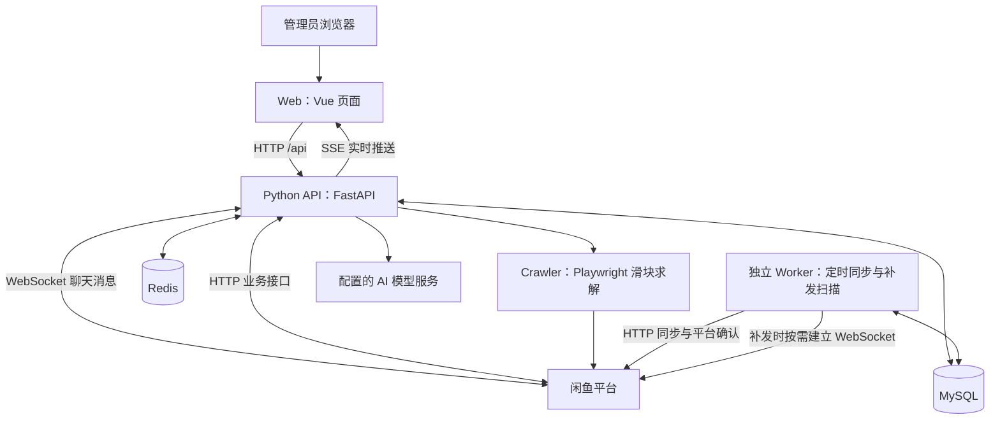
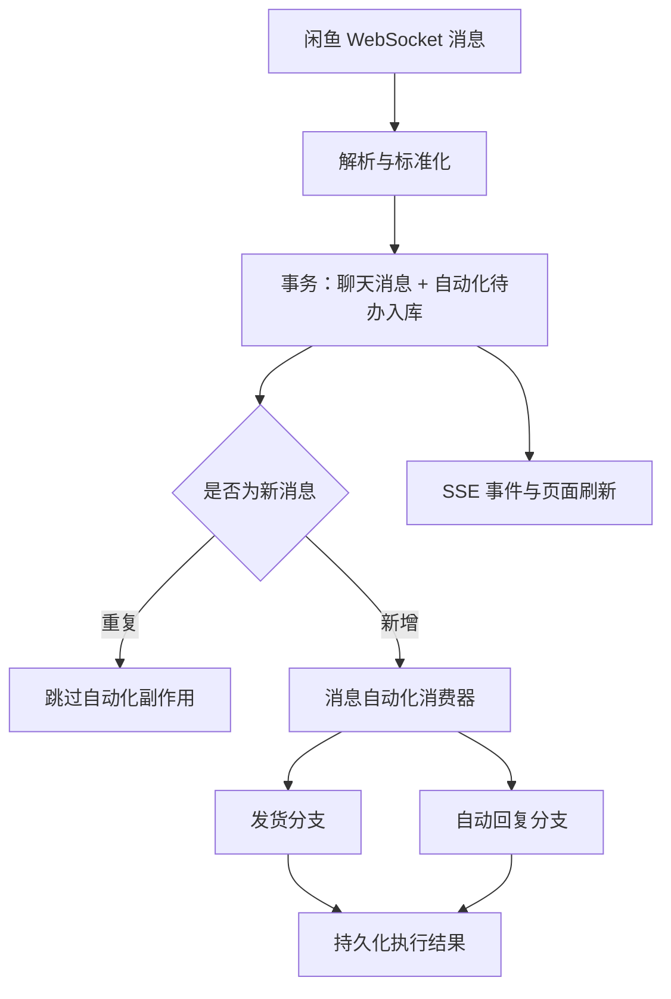

# 闲鱼助手项目基本逻辑说明

> 分析日期：2026-10-27。本文基于当前仓库代码，帮助初次接触项目的人理解系统组成、核心业务流程和代码阅读入口。本文是静态代码分析，不代表已连接真实闲鱼账号完成业务验证。

## 1. 这个项目做什么

这是一个面向闲鱼卖家的运营后台。用户在一个管理界面里接入多个闲鱼账号，管理商品、订单、聊天消息，并配置自动回复、卡密发货和定时同步等功能。

可以把它理解为一个持续工作的“店铺运营中枢”：

1. 接入账号，保存调用闲鱼所需的登录凭据。
2. 从闲鱼同步商品、订单等数据，存入本地数据库。
3. 持续接收闲鱼聊天和交易事件。
4. 根据配置执行回复、发货等动作，并记录结果。
5. 通过网页展示业务数据和实时状态，允许人工接管。

当前代码按单租户管理员模式组织。“多账号”主要指接入多个闲鱼账号，不应据此理解为一个面向多个独立商家的 SaaS 系统。

## 2. 系统由哪些部分组成



Worker 补发复用同一套发货网关代码；需要发送消息时，会在自身进程中查找或按需建立账号 WebSocket 连接。

| 组成部分 | 主要职责 | 代码入口 |
| --- | --- | --- |
| Web 前端 | 登录、页面交互、展示数据、接收实时事件 | `apps/web/src/main.js`、`App.vue` |
| Python API | 身份认证、业务接口、闲鱼连接、实时自动化 | `apps/api/run.py`、`app/main.py` |
| 独立 Worker | 定时商品/订单同步、审计清理、补发货扫描 | `apps/api/app/worker.py` |
| Crawler | 用浏览器执行滑块验证 | `apps/crawler/src/server.ts`、`sliderSolver.ts` |
| MySQL | 保存账号、商品、订单、消息、配置和任务执行状态 | `apps/api/app/models/entities.py` |
| Redis | 支持认证撤销、登录限流等共享安全状态 | `apps/api/app/core/redis_client.py` |
| Nginx | 生产环境托管前端、代理 API 和实时流 | `apps/web/nginx.conf` |

Docker Compose 定义了 `mysql`、`redis`、`migrate`、`crawler`、`api`、`worker`、`web` 七个服务。其中 `migrate` 是运行完就退出的数据库迁移任务。

### 2.1 API 和 Worker 为什么分开

API 需要及时响应页面操作、接收聊天消息；定时任务需要在后台持续扫描和执行。分成两个进程后，两者可以分别管理和检查健康状态。

不过，项目里的后台工作并非全部都放在独立 Worker 中：

| API 进程内运行 | 独立 Worker 中运行 |
| --- | --- |
| 闲鱼 WebSocket 长连接 | 用户配置的定时商品、订单同步 |
| 消息自动化 Outbox 消费器 | 自动发货恢复扫描 |
| AI 连续消息合并器 | 审计日志保留期清理 |
| Cookie/Token 刷新器 | Worker 自身心跳维护 |
| 自动评价、售罄重新上架调度器 | — |

因此，停止 API 会影响主要的实时消息与自动回复链路；停止 Worker 会影响定时同步和补发扫描。Worker 的补发能力仍可能按需建立自己的消息发送连接。

## 3. 目录和代码如何分工

```text
xianyu-pilot/
├── apps/
│   ├── web/                 Vue 前端、页面、请求封装、Nginx 配置
│   ├── api/
│   │   ├── run.py           API 启动入口
│   │   ├── app/
│   │   │   ├── main.py      应用启动、路由挂载、中间件、健康检查
│   │   │   ├── worker.py    独立后台进程
│   │   │   ├── api/v1/      路由聚合、认证依赖、业务接口
│   │   │   ├── services/    闲鱼通信、同步、自动回复、发货等逻辑
│   │   │   ├── models/      SQLAlchemy 数据模型
│   │   │   ├── schemas/     部分请求和响应数据结构
│   │   │   ├── core/        配置、数据库、安全、日志等基础能力
│   │   │   └── migrations/  数据库迁移执行器
│   │   ├── migrations/      按版本编号的 SQL 迁移文件
│   │   └── tests/           后端回归测试
│   └── crawler/            Node.js + TypeScript + Playwright
├── scripts/                初始化、启动、验证、备份恢复脚本
├── deploy/                 MySQL 初始化、TLS 代理示例
├── docs/                   部署与运行说明
└── docker-compose.yml      服务编排和依赖配置
```

后端总体遵循“路由接收请求 → 服务处理业务 → 数据模型/SQL 读写数据库 → 返回结果”的组织方式。但这不是严格分层的实现：部分较大的路由文件也包含业务处理和 SQL，阅读时需要沿实际函数调用继续追踪。

另外，虽然路由目录名为 `api/v1`，当前应用统一挂载在 `/api`，不能直接推断接口前缀是 `/api/v1`。

## 4. 从启动到可用的过程

### 4.1 初始化与迁移

启动脚本负责准备配置、密钥和依赖，并启动各服务。数据库结构由单独的迁移命令升级：

```bash
# 在 apps/api 下，使用已配置的迁移数据库凭据执行
python -m app.migrations status
python -m app.migrations upgrade
```

迁移器按照 SQL 文件编号执行，记录迁移版本和文件校验值，并使用 MySQL 锁避免迁移并发。API 和 Worker 启动时只检查数据库版本是否匹配，不负责自动建表。

### 4.2 API 启动

`run.py` 启动 Uvicorn，并加载 `app.main:app`。`main.py` 的生命周期逻辑依次准备后台任务运行环境、检查数据库结构、恢复账号连接，并启动 Token 刷新等后台能力。

账号 WebSocket 启动过程还会恢复 AI 回复的执行状态、启动消息自动化消费器，然后读取有凭据的账号并尝试建立连接。当前自动启动查询最多读取 50 个账号；这是该启动查询的限制，不等同于完整产品容量声明。

退出时，程序先停止后台任务和连接，再关闭 Redis 与数据库资源。

### 4.3 健康检查

| 检查 | 含义 |
| --- | --- |
| API `/health`、`/health/live` | API 进程能响应请求 |
| API `/health/ready` | 检查数据库、迁移、Redis、消息自动化和 Token 刷新器 |
| Crawler `/ready` | 检查配置与 Playwright Chromium 是否可用 |
| Web `/readyz` | 通过代理检查 API 的就绪状态 |
| `python -m app.worker --check` | 检查独立 Worker 心跳是否新鲜 |

这些检查用途不同。API 就绪检查没有覆盖每个账号是否在线，也不替代独立 Worker 的心跳检查。

## 5. 一次普通页面操作怎样完成

以“在页面查看订单”为例：

1. Vue 页面调用 `src/api/` 中的接口函数。
2. 统一请求封装 `src/utils/request.js` 向 `/api` 发请求，附上管理员 Bearer Token 和请求编号。
3. 开发环境由 Vite 代理到 Python API；Docker 环境由 Nginx 代理。
4. 后端验证管理员身份，路由查询订单数据。
5. 后端通常返回 `{ code, msg, data }` 结构，前端展示结果。
6. 如果认证失效、需要滑块验证或请求失败，统一请求层向界面发出对应事件。

前端 `App.vue` 使用 Hash 地址和页面映射切换视图，并按需加载页面组件。移动端有单独的轻量页面组件，共用后端业务接口。

管理员登录与闲鱼登录是两套不同的状态：前者允许使用管理后台，后者决定系统能否操作某个闲鱼账号。

## 6. 核心流程一：接入闲鱼账号

### 6.1 扫码登录

前端调用 Python API 的扫码接口生成二维码并轮询状态：

```text
POST /api/qrlogin/generate
POST /api/qrlogin/status/{session_id}
POST /api/qrlogin/cleanup
```

API 通过 `core/xianyu_qr_login.py` 管理登录会话。登录成功后，服务端将账号信息和登录凭据持久化，再启动或更新相应账号的连接。Cookie 和 Token 在保存前经过加密处理。

当前扫码入口属于 Python API。Crawler 中旧的二维码会话接口已移除，不能把它当作当前扫码登录服务。

### 6.2 账号信息分为三类

| 数据表 | 保存内容 |
| --- | --- |
| `xianyu_account` | 账号基础资料、闲鱼用户标识等 |
| `xianyu_account_auth` | 加密 Cookie、Token 等登录凭据 |
| `xianyu_account_runtime` | 在线、WebSocket、验证码等运行状态 |

这种拆分让“账号是谁”“凭据是什么”“当前是否在线”可以分别维护。

### 6.3 后续如何保持可用

`cookie_token_refresher.py` 负责刷新相关凭据；`ws_client.py` 负责账号连接、心跳、消息收发和重连。遇到滑块验证时，再通过验证码处理服务调用本地 Crawler 或配置的远程求解能力。

Crawler 当前主要暴露滑块求解接口，使用内部令牌验证调用方，并限制目标地址、并发量和操作时间。

## 7. 核心流程二：商品与订单同步

“同步”就是从闲鱼获取数据，整理后写入本地数据库，让管理界面可以查询和操作。

| 业务 | 主要服务 | 主要数据表 |
| --- | --- | --- |
| 商品同步 | `xianyu_goods_sync.py` | `xianyu_goods`、`xianyu_goods_sync_task` |
| 订单同步 | `xianyu_order_sync.py` | `xianyu_trade_order`、`xianyu_trade_order_item` |
| 商品发布、多规格编辑 | `fish_shop_publish.py` 及相关路由 | 商品、SKU、属性、编辑快照等表 |
| 退款和评价 | `refund_service.py`、`rate_service.py` | 对应退款、评价和同步任务表 |

闲鱼业务调用使用账号凭据和签名参数。`xianyu_api_service.py` 中可以看到订单查询、确认发货、登录状态检查等接口封装，其他商品能力也分布在对应服务和路由中。

同步主要有三种触发方式：

1. 用户在页面点击同步。
2. 独立 Worker 执行配置好的定时任务。
3. 收到付款事件后，API 异步触发该账号的订单同步；当前有 30 秒的账号级节流。

所以订单数据同时依赖主动拉取和实时事件。付款消息能推动同步，但收到消息不代表本地完整订单详情已立即更新。

## 8. 核心流程三：消息接收与实时展示



主要调用链是：

```text
ws_client.py
  → ws_startup.on_message_callback()
  → ws_storage.save_chat_message()
  → message_automation_outbox.enqueue_message_automation()
  → 消费器分别处理 delivery 和 ai 分支
```

Outbox 可以理解为一张“待办表”。新聊天消息和两个自动化分支在同一事务里保存，避免消息已经入库、自动回复或发货任务却因进程退出而丢失。

消费器从数据库认领待办，使用有期限的租约记录处理归属。发货和 AI 分支独立执行，单个分支失败不会要求另一个分支从头发送。

网页的实时更新主要通过 SSE 完成：浏览器先凭管理员身份申请一次性短期票据，再建立事件订阅连接。这里有两条不同的实时链路：

- 闲鱼与 Python API 之间使用 WebSocket 收发聊天消息。
- Python API 与浏览器之间使用 SSE 推送业务事件。

SSE 是进程内广播机制，不是完整的消息历史存储。聊天记录和执行状态仍以数据库为准。

## 9. 核心流程四：自动回复

### 9.1 哪些消息会进入回复流程

系统先过滤系统通知、卖家自己发出的消息等情况，避免回复通知或产生自问自答。买家连续发来多条消息时，`ai_reply_batcher.py` 会按会话等待一段安静时间，将内容合并后处理。默认延迟从配置读取，缺省为 8 秒。

### 9.2 回复的判断顺序

`automation_runtime.process_incoming_message()` 的主要顺序如下：

1. 确定当前会话关联的商品和商品事实。
2. 检查全局、账号、商品范围是否允许自动回复。
3. 检查会话是否关闭自动回复，或因人工接管而暂停。
4. 尝试匹配关键词规则，命中则直接发送配置好的文本。
5. 未命中规则时，检查 AI 客服开关、回复策略和模型配置。
6. 排除已被后续回复覆盖的迟到消息。
7. 组合提示词、知识内容、人设、聊天规则和可选历史记录。
8. 调用模型生成回复，并在实际发送前再次检查策略。
9. 通过 AI 回复执行状态记录控制发送与本地消息保存。

因此，关键词回复优先于模型生成；开启某个开关也不保证所有消息都会被回复，还要满足其他范围和策略条件。

### 9.3 RAG 与自动回复的实际关系

项目具备数据库支持的 RAG 知识库管理、文档切块、Embedding 和相似度检索能力，主要实现在 `api/v1/routes/rag.py`，数据保存在 `rag_knowledge_base`、`rag_document`、`rag_chunk`。

但当前这条 AI 自动回复链路直接读取 AI 客服配置中绑定的 `knowledgeBases` 内容，拼入系统提示词；没有在 `process_incoming_message()` 中执行每条消息的向量召回。

因此，应分别理解“系统有 RAG 管理/检索能力”和“当前自动回复如何使用知识”，不能把功能宣传直接等同于具体调用链。

## 10. 核心流程五：自动发货与卡密

### 10.1 什么会触发发货

实时发货分支识别付款等交易消息，从消息中提取账号、订单、商品、会话和买家信息，然后匹配发货配置。多规格商品还会尝试按订单 SKU 覆盖商品通用配置。

卡密仓库的基本关系是：`card_group` 管理卡密分组，`card_item` 保存具体卡密；发货时根据规则挑选并认领库存，交付后更新卡密和发货记录。

### 10.2 发货包含两个阶段

对虚拟商品来说，发货可能同时涉及：

1. 向买家发送文本、卡密或配置的交付内容。
2. 根据配置调用闲鱼接口确认平台发货。

两步需要分开记录，因为“买家收到内容”和“平台订单已标记发货”可能分别成功或失败。

`realtime_delivery.py` 中的主要执行状态为：

```text
pending
  → message_sending
  → message_sent
  → platform_confirming（启用平台确认时）
  → success

异常分支：failed / unknown
```

| 状态或字段 | 含义 |
| --- | --- |
| `message_sent` | 交付消息已确认发送，后续应继续剩余阶段 |
| `failed` | 已知失败；能否自动重试取决于 `retry_safe` 等字段 |
| `unknown` | 外部结果不明确，例如发送后未收到确认 |
| `event_key` | 一次业务事件的稳定标识；有订单号时优先按账号和订单生成 |
| `lease_token`、`lease_until` | 标识当前处理者及其有效期限 |

这种设计用于减少消息重放、重复点击和进程恢复造成的重复交付，不能直接解释为外部平台操作绝对只执行一次。

### 10.3 声明确认和补发

开启发货声明时，正常流程会先发送声明并创建等待会话，买家回复确认后再推进发货。补发扫描也会跳过等待声明确认的订单。

需要留意实际异常分支：`ws_delivery_handler.py` 中声明流程抛出异常时，会记录日志并回退到直接发货。因此当前声明机制并非所有异常情况下都会阻止交付。

独立 Worker 的 `delivery_recovery.py` 周期性扫描未完成交付的订单，重新检查订单状态、等待声明和执行记录，并复用发货协调器推进处理。

2026-10-29 的阶段 1 安全修复已关闭两条危险恢复路径：`_resurrect_dead_letter_attempts()` 不再把超过 24 小时的 unknown 转成可重试 failed；`heal_orphaned_card_claims()` 不再仅凭任务终态释放卡密。时间经过和任务终态都不能证明内容未送达，未知任务及其卡密必须保留供人工核对。

## 11. 定时任务如何执行

用户配置的定时任务保存在 `scheduled_task` 表。当前 `scheduled_task_runtime.py` 明确支持的任务类型是 `sync_goods` 和 `sync_orders`。

独立 Worker 循环扫描到期任务，通过数据库认领、有限租约和执行超时控制运行；完成后保存结果并根据 Cron 表达式计算下次时间。Worker 同时维护心跳，让部署脚本可以发现停止或异常状态。

自动评价、售罄重新上架等功能使用各自的调度器，不属于上述两种通用定时任务类型。

## 12. 数据库里的几组关键关系

| 业务 | 主要数据 | 如何关联 |
| --- | --- | --- |
| 闲鱼账号 | 基础信息、凭据、运行状态 | 通过 `account_id` 关联 |
| 商品 | 商品、属性、SKU、编辑快照 | 归属账号，并保留平台商品标识 |
| 订单 | 订单主表、订单明细 | 关联账号、平台订单与商品 |
| 消息 | 会话、聊天消息、Outbox | 关联账号、会话及消息来源标识 |
| 自动回复 | 规则、日志、AI 执行记录、日配额 | 保存决策配置与实际执行结果 |
| 发货 | 规则、卡密分组、卡密、发货记录、执行记录 | 将业务订单与库存和交付动作关联 |
| 系统设置 | `xianyu_sys_setting`、模型配置等 | 保存通用配置与业务 JSON 配置 |
| 知识库 | 知识库、文档、切块 | 文档属于知识库，切块属于文档 |

注意项目中同时存在 `xianyu_message` 和 `xianyu_chat_message` 等名字相近的表。实时消息自动化的当前主要路径使用 `XianyuChatMessage`，不要仅按表名猜测数据来源。

## 13. 安全、桥接与扩展边界

### 13.1 身份和敏感信息

管理后台使用管理员认证和 JWT，Redis 用于撤销状态、限流等控制；普通业务接口通过认证依赖验证请求。内部接口与 Crawler 调用还使用独立内部令牌。

Cookie、Token 和部分敏感配置有加密存储处理；日志有脱敏逻辑；请求编号用于把页面错误和服务端日志关联起来。文件上传、远程图片和目标 URL 也有专门校验。

### 13.2 商业版桥接

项目包含可选的 `commercial_bridge.py`，供首页内容、反馈、广告申请等功能使用。桥接地址与凭据通过服务端配置提供。

各功能的降级行为不同：部分展示内容有本地兜底；广告申请和广告支付在桥接未配置时会明确不可用。不能由存在桥接代码推断所有业务都依赖商业后端，也不能推断所有功能离线可用。

### 13.3 当前架构的部署边界

账号 WebSocket 管理器、SSE 票据与广播器、AI 消息合并器包含进程内状态。若直接增加 API 副本，可能出现重复账号连接、票据与订阅落到不同进程等问题。通用任务有数据库租约，也不代表整个 API 已具备任意水平扩容能力。

路由中还有 `frontend_compat`、`business_settings_compat`、`restful` 等兼容层。最终公开接口以 `api/v1/api.py` 的注册和排除规则为准；找到一个路由函数，不代表它一定被挂载。路由注册器也会检查重复的方法与路径。

## 14. 建议怎样阅读代码

按下列顺序阅读，可以先建立主线，再进入具体业务：

| 顺序 | 文件 | 阅读目标 |
| --- | --- | --- |
| 1 | [docker-compose.yml](../docker-compose.yml) | 看懂部署进程和依赖 |
| 2 | [main.py](../apps/api/app/main.py)、[worker.py](../apps/api/app/worker.py) | 分清启动过程和后台任务归属 |
| 3 | [API 路由聚合](../apps/api/app/api/v1/api.py) | 找到当前生效的业务接口 |
| 4 | [entities.py](../apps/api/app/models/entities.py) | 看懂核心数据结构和执行记录 |
| 5 | [ws_startup.py](../apps/api/app/services/ws_startup.py)、[ws_client.py](../apps/api/app/services/ws_client.py) | 跟踪账号连接和消息入口 |
| 6 | [message_automation_outbox.py](../apps/api/app/services/message_automation_outbox.py) | 看懂消息如何转成可靠待办 |
| 7 | [automation_runtime.py](../apps/api/app/services/automation_runtime.py) | 跟踪规则回复和 AI 回复决策 |
| 8 | [ws_delivery_handler.py](../apps/api/app/services/ws_delivery_handler.py)、[realtime_delivery.py](../apps/api/app/services/realtime_delivery.py) | 跟踪交易事件到实际交付 |
| 9 | [delivery_recovery.py](../apps/api/app/services/delivery_recovery.py) | 理解补发与恢复的真实行为 |
| 10 | [App.vue](../apps/web/src/App.vue)、[request.js](../apps/web/src/utils/request.js)、[sse.js](../apps/web/src/utils/sse.js) | 理解页面如何调用后端并接收事件 |

需要运行项目时，继续参考 [本地开发说明](local-dev-runbook.md)、[部署指南](deployment-guide.md)、[生产就绪说明](production-readiness.md) 和 [数据库迁移说明](../apps/api/migrations/README.md)。README 中存在历史版本和宣传性内容，判断当前行为时应结合实际注册路由、调用链和部署配置。
